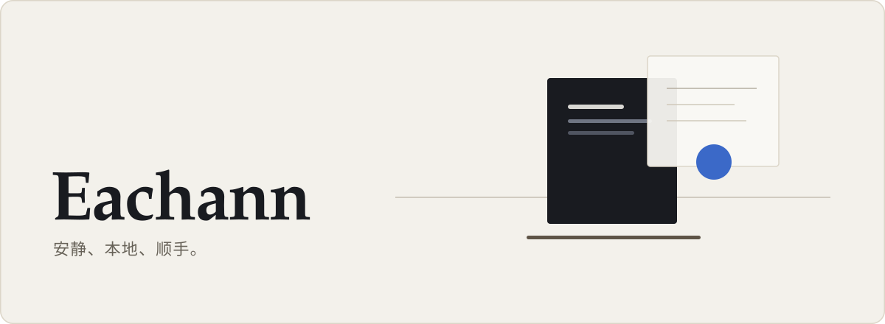
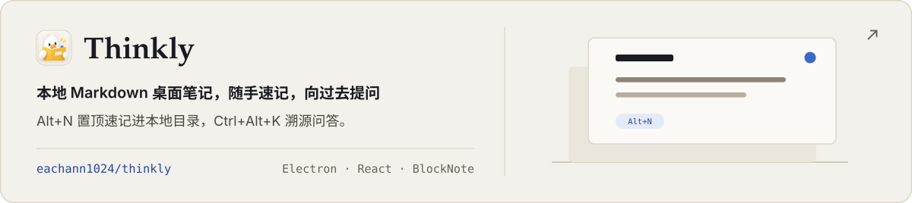
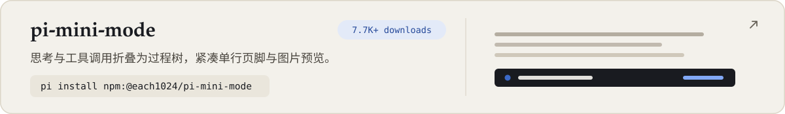
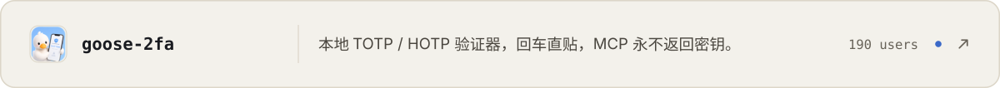
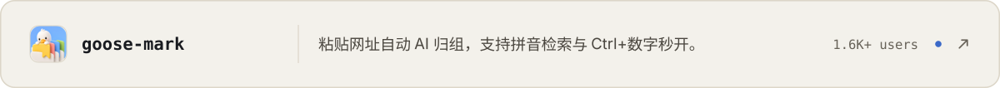
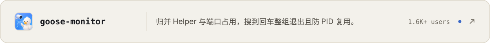

<picture><source media="(prefers-color-scheme: dark)" srcset="assets/dark/hero.svg"><source media="(prefers-color-scheme: light)" srcset="assets/light/hero.svg"></picture>

<a href="https://github.com/eachann1024/block"><picture><source media="(prefers-color-scheme: dark)" srcset="assets/dark/block.svg"><source media="(prefers-color-scheme: light)" srcset="assets/light/block.svg"></picture></a>

<a href="https://github.com/eachann1024/thinkly"><picture><source media="(prefers-color-scheme: dark)" srcset="assets/dark/thinkly.svg"><source media="(prefers-color-scheme: light)" srcset="assets/light/thinkly.svg"></picture></a>

<a href="https://github.com/eachann1024/pi-mini-mode"><picture><source media="(prefers-color-scheme: dark)" srcset="assets/dark/pi-mini-mode.svg"><source media="(prefers-color-scheme: light)" srcset="assets/light/pi-mini-mode.svg"></picture></a>
<a href="https://github.com/eachann1024/pi-final-model"><picture><source media="(prefers-color-scheme: dark)" srcset="assets/dark/pi-final-model.svg"><source media="(prefers-color-scheme: light)" srcset="assets/light/pi-final-model.svg"></picture></a>

<a href="https://github.com/eachann1024/goose-2fa"><picture><source media="(prefers-color-scheme: dark)" srcset="assets/dark/goose-2fa.svg"><source media="(prefers-color-scheme: light)" srcset="assets/light/goose-2fa.svg"></picture></a>
<a href="https://github.com/eachann1024/goose-notes-utools"><picture><source media="(prefers-color-scheme: dark)" srcset="assets/dark/goose-notes-utools.svg"><source media="(prefers-color-scheme: light)" srcset="assets/light/goose-notes-utools.svg"></picture></a>
<a href="https://github.com/eachann1024/goose-mark"><picture><source media="(prefers-color-scheme: dark)" srcset="assets/dark/goose-mark.svg"><source media="(prefers-color-scheme: light)" srcset="assets/light/goose-mark.svg"></picture></a>
<a href="https://github.com/eachann1024/goose-monitor"><picture><source media="(prefers-color-scheme: dark)" srcset="assets/dark/goose-monitor.svg"><source media="(prefers-color-scheme: light)" srcset="assets/light/goose-monitor.svg"></picture></a>
