<table>
<tr>
<td width="50%" valign="top">

[](https://github.com/eachann1024/goose-notes)

###  [goose-notes](https://github.com/eachann1024/goose-notes)

**Local Markdown. Quick capture. AI.**

直接打开本地 Markdown 文件夹写作，独立速记小窗随时记下灵感；AI 可引用已有笔记提炼重点或改写指定段落，原文与对话并排对照。
支持代码、公式、Mermaid 与表格，可导出 Markdown / HTML / PDF / Word / 图片，并有页面锁定与历史版本；提供 macOS、Windows、Linux 安装包。

`TypeScript · React · Electron · BlockNote`

</td>
<td width="50%" valign="top">

[](https://github.com/eachann1024/goose-herdr-gpui)

###  [goose-herdr-gpui](https://github.com/eachann1024/goose-herdr-gpui)

**Sessions. SSH. Split terminals.**

Goose Herdr 的 macOS 原生客户端，用 Rust + GPUI 管理 Herdr 会话、SSH 连接与终端分栏。
终端基于 Zed 终端核心与批量网格渲染，沿用原有 Herdr 协议、偏好和 Keychain，退出界面不会关闭共享 daemon。

`Rust · GPUI · gpui-component · zed-terminal`

</td>
</tr>
</table>



<table>
<tr>
<td width="33%" valign="top">

### [pi-jev-route](https://github.com/eachann1024/pi-jev-route)

**The right model for the task.**


子代理派发时由 Jev 从你启用的模型中自动选型，主会话的模型与思考强度保持不变。
附带本地设置与审计控制台：配置回退策略和置信度门槛，监督长时间任务，并回看每次派发的决策原因与时间线。

`TypeScript · Pi Extension API · Pi AI`

```sh
pi install npm:@each1024/pi-jev-route
```

</td>
<td width="33%" valign="top">

### [pi-jev-reply](https://github.com/eachann1024/pi-jev-reply)

**Less noise. More clarity.**


为 Pi 回复做最后一道润色：由 Jev 判断是否需要修改，再用当前或所选模型改得更直白，必要时补一张小表格或流程图。
结构校验会拒绝丢失引用或改动数字的编辑，改写失败时保留原文；中英双语设置页。

`TypeScript · Pi Extension API · Pi TUI`

```sh
pi install npm:@each1024/pi-jev-reply
```

</td>
<td width="33%" valign="top">

### [pi-mini-mode](https://github.com/eachann1024/pi-mini-mode)

**Less noise. More focus.**


输入框上方预览图片，`/` 直接插入技能；极简输出把思考、工具调用汇成可折叠的过程树，子代理详情点开即看。
紧凑页脚一行显示模型、令牌、缓存命中率、费用估算与上下文用量，自带 cc-light / cc-dark 主题。

`TypeScript · Pi TUI · grok-mermaid`

```sh
pi install npm:@each1024/pi-mini-mode
```

</td>
</tr>
</table>

## Tools, within reach.

<table>
<tr>
<td width="50%" valign="top">

###  [goose-2fa](https://github.com/eachann1024/goose-2fa)

**Local codes, close at hand.**


uTools 插件，主框输入 `2fa github` 回车，验证码直接贴到上一个窗口；TOTP 与 HOTP 同屏管理。
支持粘贴 Google Authenticator 迁移码和 otpauth 链接，备份保留分组与备注；MCP 只读脱敏元数据，永不返回种子和动态码。

`TypeScript · React · uTools · MCP`

</td>
<td width="50%" valign="top">

###  [raycast-2fa](https://github.com/eachann1024/raycast-2fa)

**Codes at command speed.**

Raycast 上的本地 TOTP / HOTP 管理器：粘贴 Base32 密钥，或用 Swift Vision 识别截图和图片里的二维码添加账户，回车复制或粘贴验证码。
可导出为二维码或 otpauth 链接迁移到手机，支持 JSON 备份，并可与 uTools 版共用同一份数据文件。

`TypeScript · Raycast API · Swift Vision`

</td>
</tr>
<tr>
<td valign="top">

###  [goose-monitor](https://github.com/eachann1024/goose-monitor)

**Know what is running.**


把 Electron、Chrome 的 Helper 归并到所属应用，搜到回车即整组结束；输入端口号就能找到占用者。
可按界面应用、CPU、内存、网络等分类查看实时网速，结束前用快照复核，避免误杀复用 PID 的进程；附带 MCP 服务。

`TypeScript · Vite · uTools · MCP`

</td>
<td valign="top">

###  [raycast-monitor](https://github.com/eachann1024/raycast-monitor)

**Find. Inspect. Quit.**

按应用名、PID 或端口查找进程，Helper 与子进程归并到所属应用，回车直接结束整个应用，顽固进程可强制退出。
结束前复核进程身份，按从子到父的顺序发送信号防止重启；网速只在网络分类采样，另带 CPU 菜单栏。

`TypeScript · React · Raycast API / Utils`

</td>
</tr>
<tr>
<td colspan="2" valign="top">

###  [goose-mark](https://github.com/eachann1024/goose-mark)

**Keep the web within reach.**


主框粘贴网址即可入库，AI 自动润色标题、简介并归组；URL 中写 `{query}` 的书签可当搜索引擎，Tab 填参打开。
支持拼音搜索、`Ctrl+数字` 秒开前 10 个书签，图标本地缓存，并在本机探测死链。

`TypeScript · React · Vite · uTools · AI SDK`

</td>
</tr>
</table>
